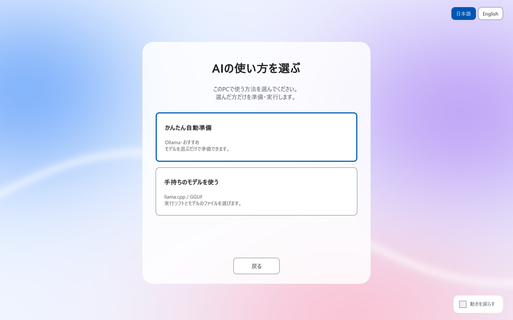
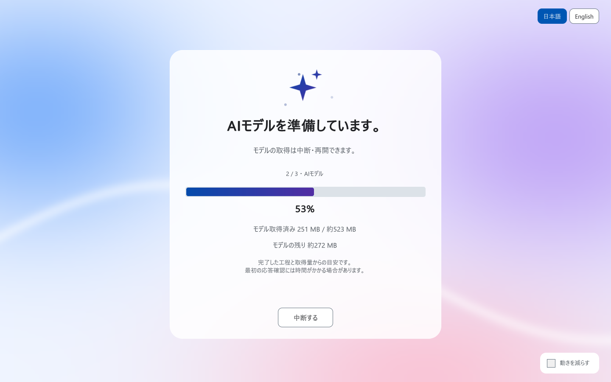
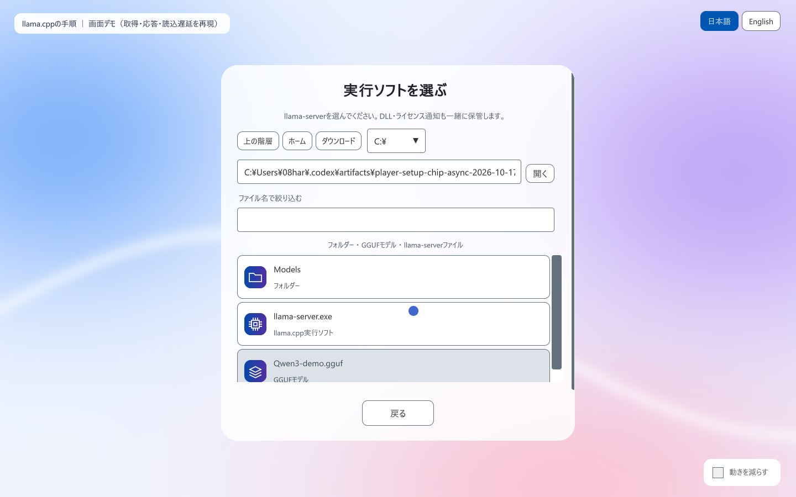
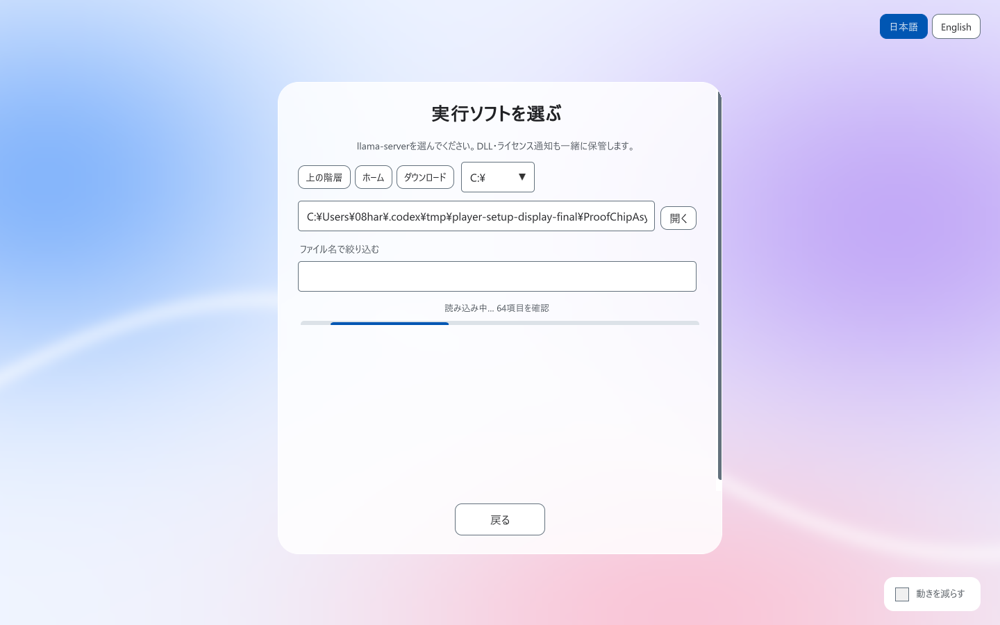
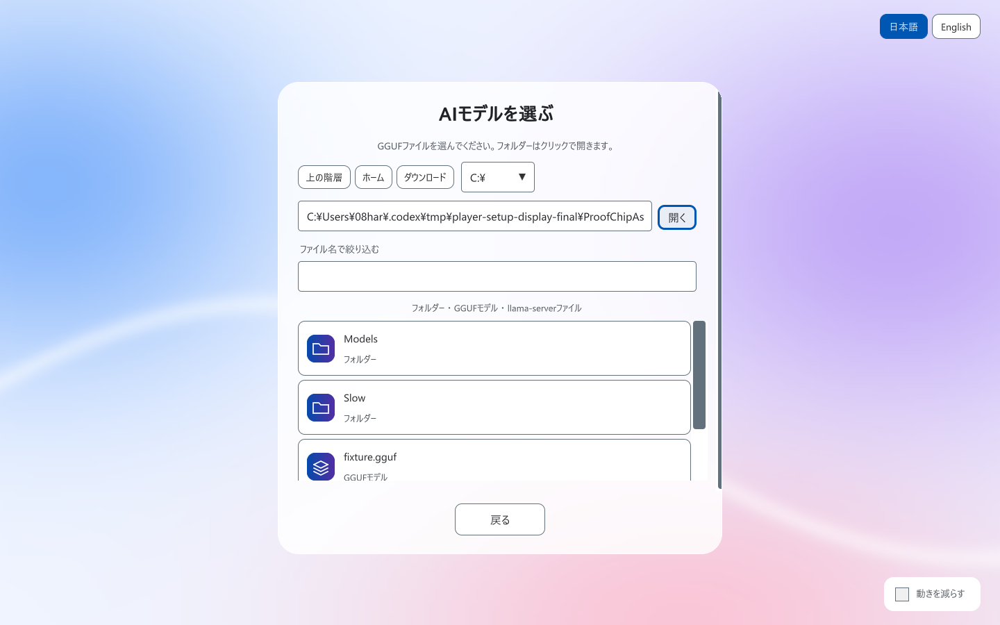
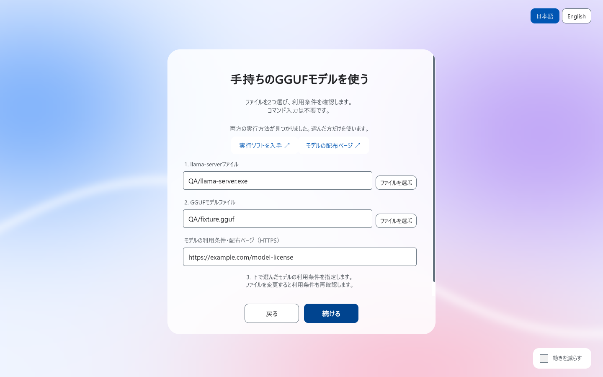
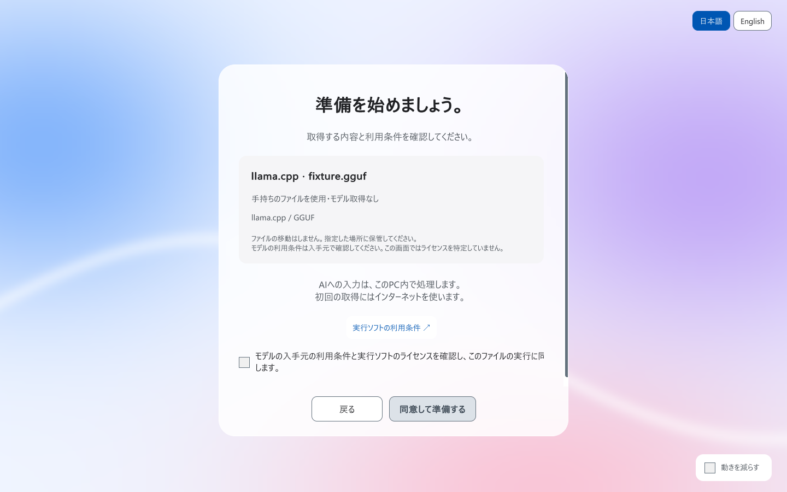
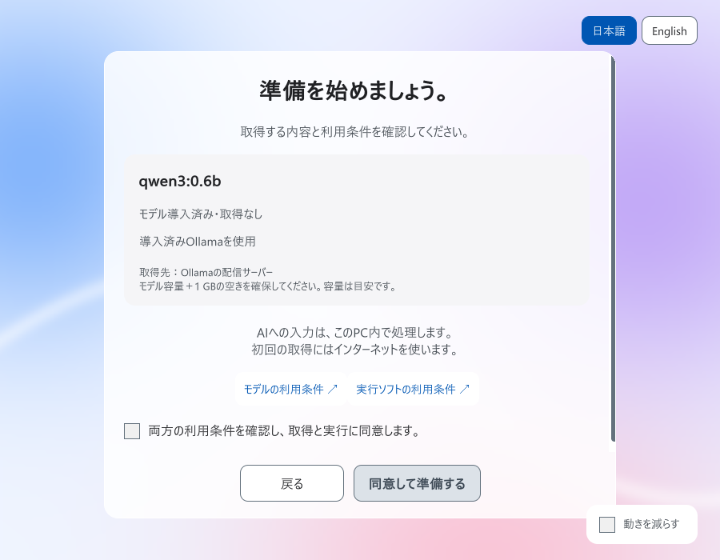

# Player setup validation

## llama.cpp ZIP setup — 2026-11-03

The Windows setup accepts a player-selected runtime ZIP and GGUF. It reviews the archive without extracting, then extracts only after explicit consent. The managed install retains folders, DLLs, licenses and notices. A temporary directory is published only after successful extraction. Cancellation/failure cleans only that operation's staging directory and preserves source files and previous settings. A reviewed SHA-256 detects archive changes; it does not authenticate the publisher. No native runtime or model is bundled.

Unity 6000.3.27f2: **171 Unit tests passed, 0 failed, 2 optional live-model tests skipped**; **130 offline Canvas assertions passed**. Inert ZIP fixtures exercise nested files, reuse, damaged/source-only/multiple-runtime archives, architecture mismatch, traversal/symlinks/path conflicts, entry limits, changed archives, cancellation, space/access errors and consent-gated extraction. Canvas checks cover ZIP selection/type labels, review, extracted/remaining bytes, pause without save, actionable errors and return to file selection. The corrupt-archive test initially exposed an uncaught `InvalidDataException`; both review and extraction now map it to the localized ZIP error. The UI suite was run separately after the Unit runner's scene transition; the helper now opens the saved setup scene when absent. No fixture executable/model was executed or loaded. A fresh Player build and an actual vendor runtime ZIP/native generation remain unverified.

Reproduce using the offline menus below. In a controlled Windows host, manually choose the correct official runtime ZIP and a GGUF, review terms, consent, check extraction progress and verify a real response before settings save. Repeat with a damaged ZIP, source-code ZIP, wrong architecture, ZIP changed after review, insufficient space, inaccessible destination and cancellation; confirm actionable Japanese/English guidance and unchanged prior settings. Use **Update ZIP Guidance** to update the existing Canvas labels without rebuilding custom layout. Historical recordings below predate ZIP support.

## Model terms resolution — 2026-11-03

Manual and restored Ollama selections resolve `LicenseUrl` by their selected catalog name. Setup no longer substitutes a guessed Ollama library page or `DownloadUrl` for a missing license. When no registered page exists, it reads the selected tag's `license` text from the already-running loopback Ollama `/api/show`. Missing/unavailable/invalid/oversized metadata falls back to explicit Japanese/English manual source-review instructions with no model terms link. This metadata lookup does not start a runtime, pull weights or generate a response.

The existing scene layout was preserved and a saved Canvas terms viewer added. Long text uses plain-text rendering, scrolling and pagination; viewing it never checks consent. Metadata lookup disables consent until it finishes, and cancellation/generation guards discard old model responses. Ollama source-review receipts now persist without a fabricated URL; supplied text records a SHA-256 digest. The legacy GGUF-only receipt still cannot substitute for Ollama review.

Unity 6000.3.27f2: **147 Unit tests passed, 0 failed, 2 optional live-model tests skipped**, followed by **121 offline Canvas assertions passed**. Added checks cover exact model/license association, manual receipt and text digest, HTTP request model/path, missing/malformed/oversized/404 metadata, authored viewer pagination/plain text/language, no automatic consent, fitting manual instructions, pending-state gating and stale results. A read-only request to the existing Ollama service returned **8,432 license characters for gemma3:4b**; no runtime was launched and no inference/download was performed. A fresh Player build was not run.

To reproduce both suites in the open validation project, install `SetupCanvasValidation.cs.txt` under `Assets/Editor` and choose **Tools > AIDrivenFW > Canvas Setup > Validate All Offline**. Results are `unit.xml` and `result.txt` under `FrameworkCanvasProof` in the OS temp folder (or `SETUP_QA_OUTPUT`). To extend an older Canvas scene without replacing its existing layout, use **Add Terms Viewer** once; imported current packages already contain these controls.

## Canvas update — 2026-11-03

Unity 6000.3.27f2 compiled the sample in the existing Windows project. The saved scene now contains a uGUI Canvas, 8 slides, 218 RectTransforms and 8 reusable browser rows. Scene GUID and existing Build Settings entry were preserved. All visual objects and sprite references exist before Play; runtime code switches panels and updates data. Text uses the bundled, unmodified OFL Noto Sans JP font.

**99 offline Canvas assertions passed in Editor Play Mode**, including every controller object reference, active input module, navigation raycast/pointer handler, Japanese/English glyph coverage, explicit runtime choice with both available, config model choices, file icons/type restrictions, slow reads, cancellation/stale results, timeout/recovery, URL-free local-source consent, consent gating, pause without commit, received/remaining byte labels and commit only after injected verification. No acquisition or native inference was performed. The Runtime Unit suite, fresh Player build and live inference were not rerun for this Canvas update. Earlier Player recordings and proof frames below show the preceding UI Toolkit presentation.

To reproduce the current Canvas checks, import the regenerated setup package, open `Assets/AIDrivenFW/AISetup/AIDrivenSetup.unity`, copy `Tools/UnityValidation/SetupCanvasValidation.cs.txt` to `Assets/Editor/SetupCanvasValidation.cs`, then choose **Tools > AIDrivenFW > Canvas Setup > Validate Offline**. It enters and exits Play automatically, restores process PATH and language/motion preferences, and writes `FrameworkCanvasProof/result.txt` under the OS temporary directory. The marker runtime/model files are inert and never executed or loaded. Use a separate validation project when replacing custom setup assets.

Manual layout check: expand **AI Setup Canvas > Glass Card** before Play. Select the Canvas controller and use its **Preview** buttons for each slide. Inspect Japanese/English, the four-step setup bar, download bytes, consent text, motion preference and file scrolling at 1440×900 and 900×700. Changes to positions, labels and icons are ordinary scene edits; do not run **Rebuild Authored Scene** over custom work without saving it separately.

## Previous UI Toolkit validation

Validated on 2026-10-17 JST with Unity 6000.3.10f1 and Windows x64. Current presentation/flow proof uses an isolated project and injected offline services. It does not represent a new live inference or download run.

| Check | Observed result |
| --- | --- |
| EditMode `AIDrivenFW.Tests.Unit` | Unchanged Runtime/Unit suite: last run at `899a6b4`, **143 passed, 0 failed, 2 optional live-model tests skipped**, exit 0; not rerun for this sample-only update |
| Artifact / build | Clean-host import, compilation and Windows Player build succeeded; final build exit 0 |
| Offline Player UI | 31 assertions passed; final Player exit 0 |
| Runtime choice | Both available paths require explicit player choice; only that choice is passed to the injected services |
| Game config | Model name, source, license, capacity and tier come from `ModelInfoConfig`; custom catalogs are not overwritten; missing metadata requires review |
| GGUF | In-game file selection reaches consent without typing a URL; config terms are available; changing the file clears its configured terms association; source-review receipt persists without an invented license URL |
| Capacity | Distinct layers aggregate to 251 MB; remaining estimate is 272 MB out of a configured 523 MB; current step and total progress are visible |
| Rendering | Analytic edge coverage and filtered 4× gradient icon inspected in the Player; glass, Japanese/English, full consent at 900×700 and completion checked |
| Contrast | Glass text >=5.71:1; 101 gradient samples >=8.15:1 against white and >=6.25:1 against the progress track |
| In-game file browser | Clicks select runtime/model files and return to setup; folder/up navigation, filtering, gradient vector type icons, opposite-type restrictions, unrelated executable exclusion and Japanese/English checked |
| Slow folder reads | Worker-thread listing/size reads; visible indeterminate bar; navigation/back during delay; cancelled and stale-result protection; timeout recovery and unreadable-folder cleanup tested |
| Distribution | 41 assets, 40,325 bytes; deterministic export and source/index/import parity checked |

Package SHA-256: `dee33de420d052ec018a16e2f1fe12572182c2c2356aa8c9214281bb9c51e42b`. No weights, runtime executables, proprietary fonts or third-party art are included. The icon and frosted backdrop are generated by code. Runtime file glyphs now depict a processor chip rather than a playback triangle.

Fixture coverage also includes consent, acquisition ordering, cancellation/retry/restart, failures before commit, space preflight, incomplete/error pulls, remote-model rejection, empty generation, atomic save failure, checksum mismatch and archive traversal. Tests also verify config snapshots, legacy metadata review, aggregated remaining capacity, URL-free player-owned GGUF consent/JSON restoration, invalid runtime selection, refusal with no side effects, rejection of applying local review to Ollama acquisition, and correct distribution-page paths for standard/namespaced tags.

## Previous live verification

The earlier `0ca710e` snapshot passed real local Ollama/Qwen3 0.6B greeting generation, automatic additive return, subsequent readiness generation and scene skip, refusal, saved-model restoration and monotonic progress. Its runtime suite passed 133 tests. The `899a6b4` update ran the expanded 143-test suite. The current sample-only update rebuilt the Windows Player and ran the 31 offline UI assertions and three recorded walkthroughs; the unchanged Runtime suite was not rerun.

One earlier snapshot wrote passing test results but the Editor crashed in native asset-worker communication during shutdown; the identical rerun exited 0. The preceding 143-test Runtime run and current offline Player/build exited 0.

## Remaining validation

- Live llama.cpp generation for this update; offline GGUF marker files are never loaded or executed.
- Full first runtime acquisition/launch without Ollama, actual OS/security prompts or a physical disk filling.
- File-browser interaction on other operating systems/architectures, varied GPUs/low-memory PCs and arbitrary GGUF/runtime combinations. The native Windows adapter has been replaced by the in-game browser.
- A fresh full model download through the new UI. Capacity rendering uses controlled progress events and parser/aggregation fixtures; the older live run used an installed model.

## Reproduce

```powershell
python Tools/package_aisetup.py
python Tools/check_setup_contrast.py
./Tools/UnityValidation/run.ps1 -DisplayOnly -Unity 'C:/Unity/6000.3.10f1/Editor/Unity.exe'
```

The runner creates a new host, imports the package, runs Unit tests, builds a Player and injects `IPlayerSetupServices` for screen/flow checks. It uses inert marker files, makes no model downloads or inference-process launches and restores language/motion preferences. Actual source, assertions and fixture sizes are reviewable in `Tools/UnityValidation/SetupDisplayRunner.cs.txt`.

For real installed-Ollama validation, omit `-DisplayOnly` with local Ollama and `qwen3:0.6b` available. Optional live GGUF validation uses `SETUP_LLAMA_RUNTIME` and `SETUP_LLAMA_MODEL`; review the actual model terms at its source before consenting. The detailed [English guide](player-setup.md) / [Japanese guide](ja/player-setup.md) covers config migration and manual failure/platform checks.

## Proof frames (offline fixtures)

These are real rendered UI frames with controlled service responses. The 251 MB / 272 MB figures, sample files and source-review receipt are fixture data. No model license is inferred from the fixture filename.











## Recorded walkthroughs

Three local recordings cover Ollama only, the llama.cpp file-browser procedure, and explicit selection with both runtimes present. Actual Unity UI is rendered at 1440×900, with injected acquisition/response services and deliberate read latency. The loading-bar recording does not claim a real slow network mount. The OS can finish a blocked filesystem call after cancellation; request disposal/generation guards prevent it from updating a newer or closed browser. The default read timeout is 15 seconds; the deterministic timeout fixture uses a shorter injected duration.

The three clips and their combined 1 minute 54 second MP4 were fully decoded without errors (H.264, 1440×900, 30 fps, no audio).
