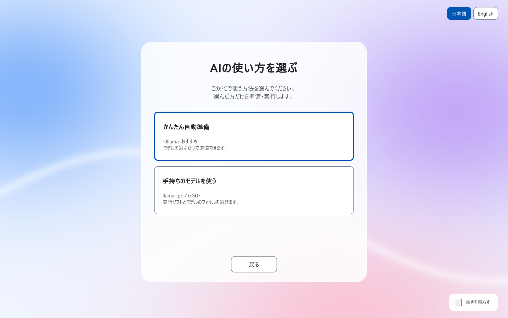
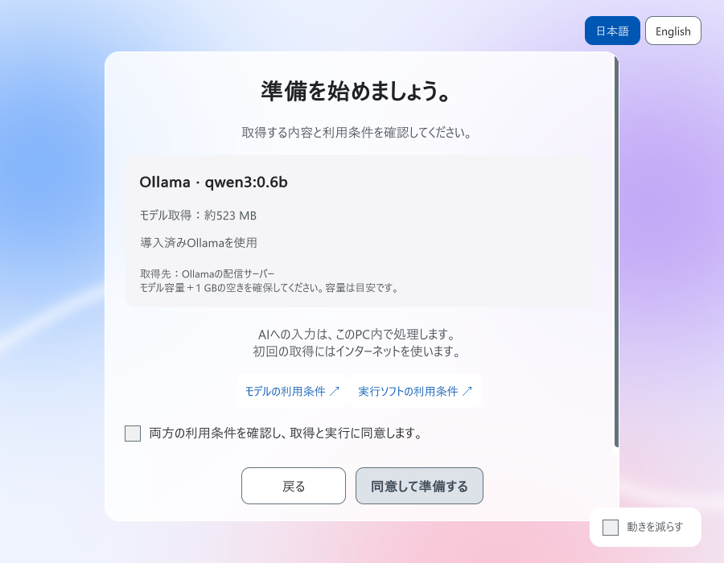

# Player setup validation

Validated on 2026-10-17 JST with Unity 6000.3.10f1 and Windows x64. Current presentation/flow proof uses an isolated project and injected offline services. It does not represent a new live inference or download run.

| Check | Observed result |
| --- | --- |
| EditMode `AIDrivenFW.Tests.Unit` | **139 passed, 0 failed, 2 optional live-model tests skipped**, exit 0 in both validation hosts |
| Artifact / build | Clean-host import, compilation and Windows Player build succeeded; final build exit 0 |
| Offline Player UI | 16 assertions passed; final Player exit 0 |
| Runtime choice | Both available paths require explicit player choice; only that choice is passed to the injected services |
| Game config | Model name, source, license, capacity and tier come from `ModelInfoConfig`; custom catalogs are not overwritten; missing metadata requires review |
| GGUF | File workflow reaches consent; old Ollama terms are not inherited; file changes clear the model license; selected mode and terms reach the fixture commit |
| Capacity | Distinct layers aggregate to 251 MB; remaining estimate is 272 MB out of a configured 523 MB; current step and total progress are visible |
| Rendering | Analytic edge coverage and filtered 4× gradient icon inspected in the Player; glass, Japanese/English, full consent at 900×700 and completion checked |
| Contrast | Glass text >=5.71:1; 101 gradient samples >=8.15:1 against white and >=6.25:1 against the progress track |
| File dialog adapter | Windows x64 native structure layout checked (152 bytes); actual dialog interaction not exercised |
| Distribution | 41 assets, 35,357 bytes; deterministic export and source/index/import parity checked |

Package SHA-256: `e8a9cc5fa0fc20b6d302ebc12642bfbefb4499bc4d0e772d67177fc31c702e4d`. No weights, runtime executables, proprietary fonts or third-party art are included. The icon and frosted backdrop are generated by code.

Fixture coverage also includes consent, acquisition ordering, cancellation/retry/restart, failures before commit, space preflight, incomplete/error pulls, remote-model rejection, empty generation, atomic save failure, checksum mismatch and archive traversal. New tests verify config snapshots, legacy metadata review and aggregated remaining capacity without double-counting or reporting completion early.

## Previous live verification

The earlier `0ca710e` snapshot passed real local Ollama/Qwen3 0.6B greeting generation, automatic additive return, subsequent readiness generation and scene skip, refusal, saved-model restoration and monotonic progress. Its runtime suite passed 133 tests. The current update reran the expanded 139-test suite and offline screen/flow fixtures, rather than claiming a new live inference run.

One earlier snapshot wrote passing test results but the Editor crashed in native asset-worker communication during shutdown; the identical rerun exited 0. Current 139-test runs and final offline Player/build exited 0.

## Remaining validation

- Live llama.cpp generation for this update; offline GGUF marker files are never loaded or executed.
- Full first runtime acquisition/launch without Ollama, actual OS/security prompts or a physical disk filling.
- Native file-dialog interaction, other operating systems/architectures, varied GPUs/low-memory PCs and arbitrary GGUF/runtime combinations.
- A fresh full model download through the new UI. Capacity rendering uses controlled progress events and parser/aggregation fixtures; the older live run used an installed model.

## Reproduce

```powershell
python Tools/package_aisetup.py
python Tools/check_setup_contrast.py
./Tools/UnityValidation/run.ps1 -DisplayOnly -Unity 'C:/Unity/6000.3.10f1/Editor/Unity.exe'
```

The runner creates a new host, imports the package, runs Unit tests, builds a Player and injects `IPlayerSetupServices` for screen/flow checks. It uses inert marker files, makes no model downloads or inference-process launches and restores language/motion preferences. Actual source, assertions and fixture sizes are reviewable in `Tools/UnityValidation/SetupDisplayRunner.cs.txt`.

For real installed-Ollama validation, omit `-DisplayOnly` with local Ollama and `qwen3:0.6b` available. Optional live GGUF validation uses `SETUP_LLAMA_RUNTIME`, `SETUP_LLAMA_MODEL` and `SETUP_LLAMA_TERMS`; use the correct terms for the chosen model. The detailed [English guide](player-setup.md) / [Japanese guide](ja/player-setup.md) covers config migration and manual failure/platform checks.

## Proof frames (offline fixtures)

These are real rendered UI frames with controlled service responses. The 251 MB / 272 MB figures and sample GGUF/license are fixture data.






