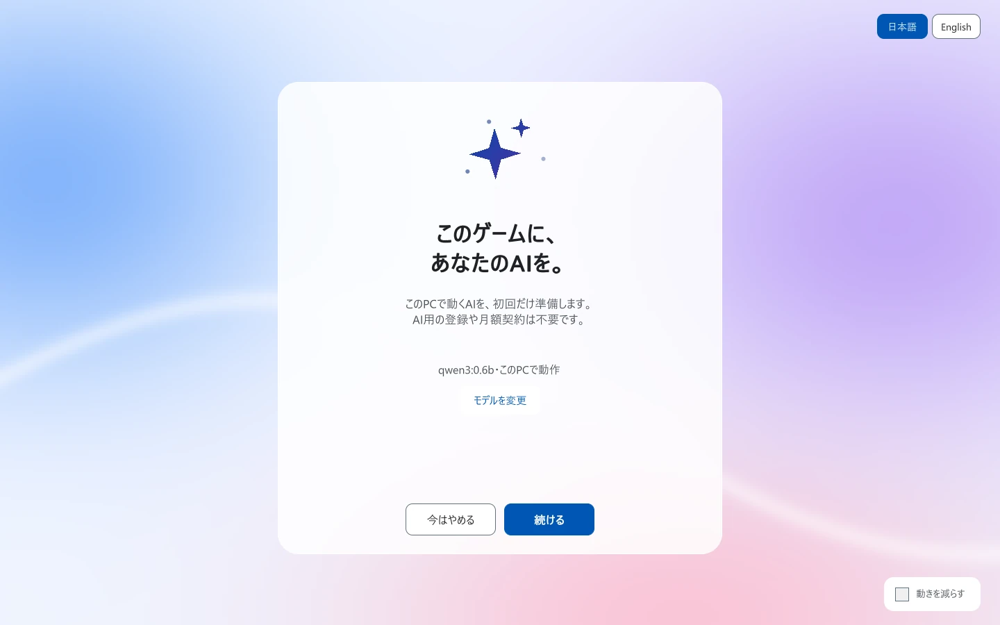
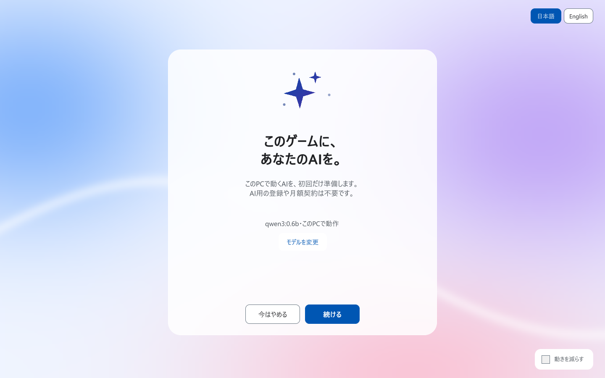
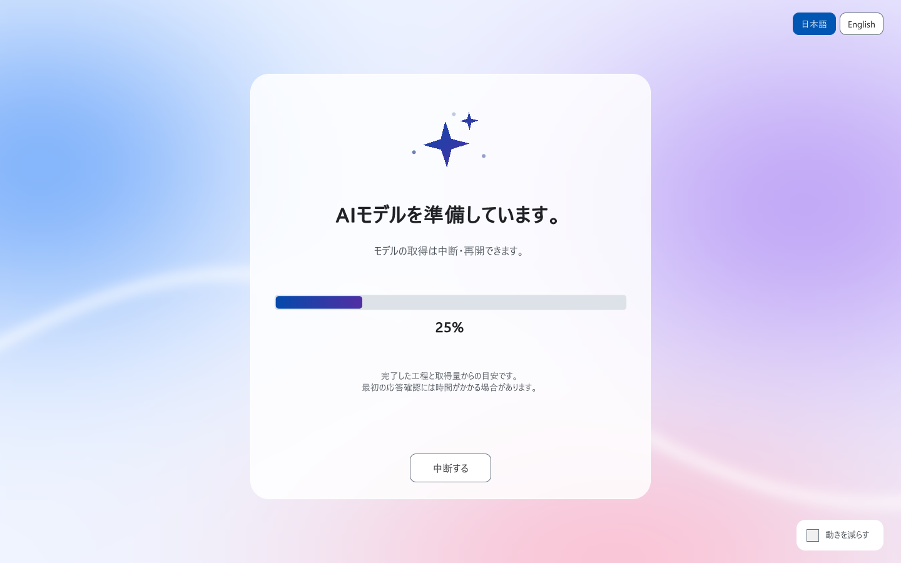

# Player setup validation

Validated on 2026-10-17 JST with Unity 6000.3.10f1, Windows x64, an isolated project and a real local Ollama service with Qwen3 0.6B installed.

| Check | Observed result |
| --- | --- |
| EditMode `AIDrivenFW.Tests.Unit` | 133 passed, 0 failed, 2 optional live-model tests skipped; final rerun exited 0 |
| Clean-host automation | Import, tests, Windows Player build and Player smoke completed with exit 0 |
| Final build / Player | Exit 0 after final source import, including legacy-settings review |
| Motion / glass | Animated gradient backdrop and frosted card; abstract gradient icon; default motion on and reduce-motion stops floating; final Player exit 0 |
| UI | Exactly one slide visible; live English/Japanese switching; 1440×900 and 900×700 |
| Consent | Unchecked initially; acquisition disabled; model changes clear consent; refusal returns false |
| Restoration | Legacy model tag retained and routed to license/size review; verified settings restored |
| Real AI | Short greeting verified, receipt saved, additive scene returned automatically; subsequent real readiness generation skipped setup |
| Progress | Monotonic across stages/layers; 100% only after verification and commit; completion shows a full bar |
| Contrast | Declared palette checked; actual resolved active-language/primary/disabled text checked at 7.04:1 / 9.44:1 focused / 7.39:1 |
| Distribution | 40 assets; source, Git index and imported code checked against the UnityPackage; reproducible export |

The final package SHA-256 is `a1c8abceda8956b696f860a6b3affd36eba18f9e01bde780c69f9e677dff0149`. It contains no model weights, runtime executables, proprietary font files or legacy image/prefab assets. Earlier helper script identities are retained for upgrades.

Fixture coverage includes failure before commit, cancellation and retry, restart requiring agreement, space preflight, missing model/error HTTP responses, incomplete pulls, remote-model rejection, empty generation, atomic settings replacement, checksum mismatch and archive traversal. It also verifies that automatic generation recovery stops when initialization returns false.

One earlier test run wrote a passing 133/0 result but the Editor then crashed in native `WorkerManagerASIO` communication during shutdown. The identical rerun exited 0; the cause was not established. This is distinct from a failed test or a Player crash.

The presentation follow-up reran artifact import, compilation, Windows Player build, real Ollama generation and UI smoke, plus glass/gradient contrast checks. The runtime EditMode suite above was unchanged and was not repeated for this visual-only update. Glass secondary text is at least 5.71:1; 101 accent samples have at least 8.15:1 against white, 6.25:1 against the progress track and 5.61:1 against the darkest hypothetical glass. Slide text stays fully opaque during animation.

## Not yet verified

- Full acquisition and first launch on a machine without Ollama. Hash/extraction protections were exercised with fixture archives; the live smoke used an installed service.
- macOS, Linux, Windows ARM, driver compatibility across GPUs and all low-memory machines.
- A physical disk filling during a download or an actual OS security prompt. Space and failure contracts were tested with preflight/fixtures.
- Every custom GGUF/runtime combination. The file path workflow is implemented; the main live run used Ollama.

Reproduce with [the setup guide](player-setup.md#validation-procedure) and `Tools/UnityValidation/run.ps1`. The runner checks prerequisites before starting, creates a new host rather than resetting an existing project and restores its saved settings/preferences.

## Proof frames

