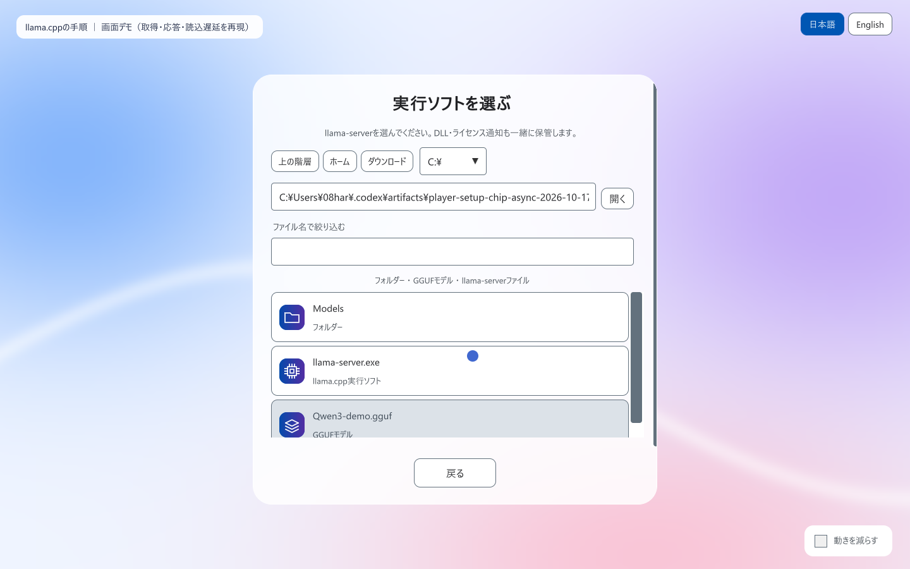
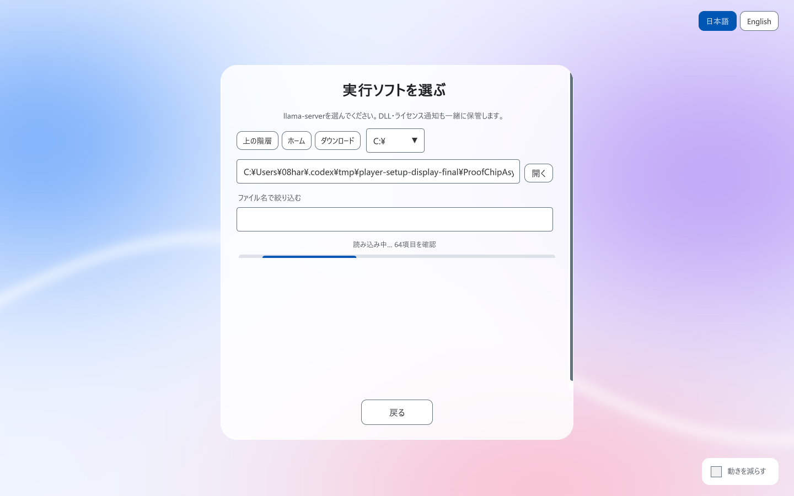
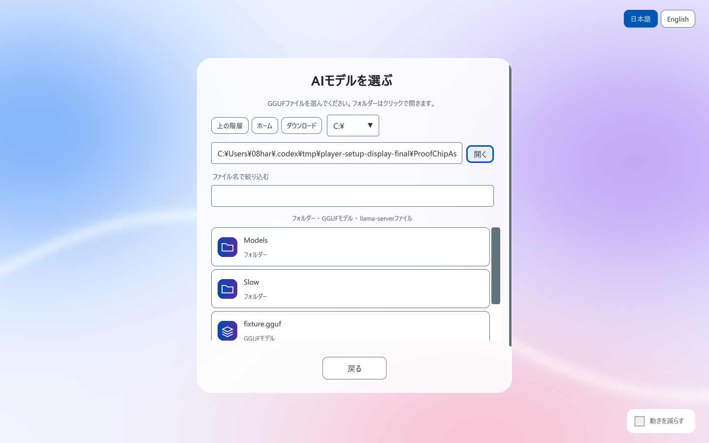
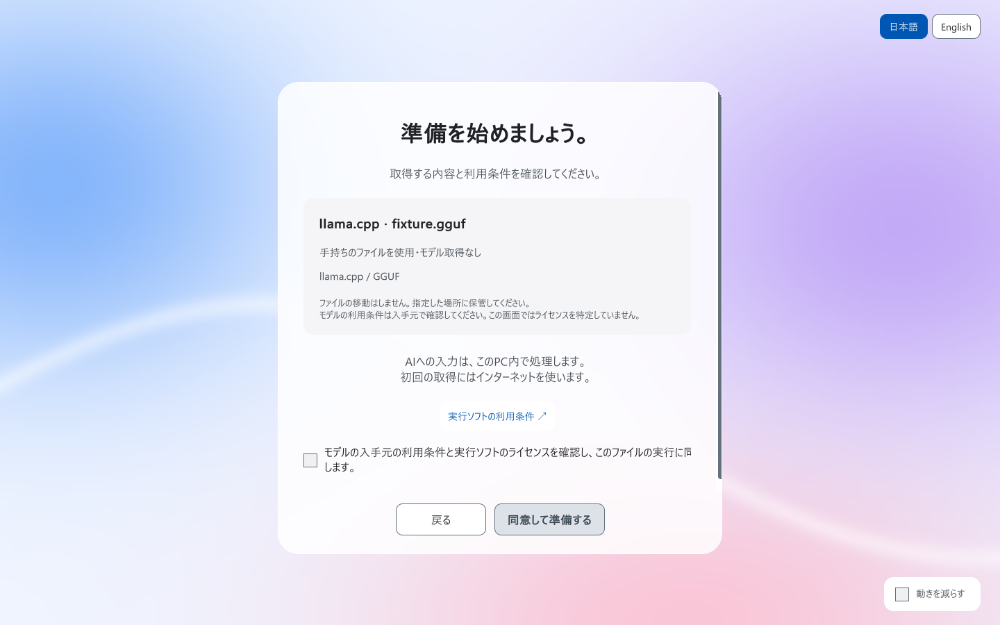

# Player setup validation

Validated on 2026-10-17 JST with Unity 6000.3.10f1 and Windows x64. Current presentation/flow proof uses an isolated project and injected offline services. It does not represent a new live inference or download run.

| Check | Observed result |
| --- | --- |
| EditMode `AIDrivenFW.Tests.Unit` | Unchanged Runtime/Unit suite: last run at `899a6b4`, **143 passed, 0 failed, 2 optional live-model tests skipped**, exit 0; not rerun for this sample-only update |
| Artifact / build | Clean-host import, compilation and Windows Player build succeeded; final build exit 0 |
| Offline Player UI | 31 assertions passed; final Player exit 0 |
| Runtime choice | Both available paths require explicit player choice; only that choice is passed to the injected services |
| Game config | Model name, source, license, capacity and tier come from `ModelInfoConfig`; custom catalogs are not overwritten; missing metadata requires review |
| GGUF | In-game file selection reaches consent without typing a URL; config terms are available; changing the file clears its configured terms association; source-review receipt persists without an invented license URL |
| Capacity | Distinct layers aggregate to 251 MB; remaining estimate is 272 MB out of a configured 523 MB; current step and total progress are visible |
| Rendering | Analytic edge coverage and filtered 4× gradient icon inspected in the Player; glass, Japanese/English, full consent at 900×700 and completion checked |
| Contrast | Glass text >=5.71:1; 101 gradient samples >=8.15:1 against white and >=6.25:1 against the progress track |
| In-game file browser | Clicks select runtime/model files and return to setup; folder/up navigation, filtering, gradient vector type icons, opposite-type restrictions, unrelated executable exclusion and Japanese/English checked |
| Slow folder reads | Worker-thread listing/size reads; visible indeterminate bar; navigation/back during delay; cancelled and stale-result protection; timeout recovery and unreadable-folder cleanup tested |
| Distribution | 41 assets, 40,325 bytes; deterministic export and source/index/import parity checked |

Package SHA-256: `dee33de420d052ec018a16e2f1fe12572182c2c2356aa8c9214281bb9c51e42b`. No weights, runtime executables, proprietary fonts or third-party art are included. The icon and frosted backdrop are generated by code. Runtime file glyphs now depict a processor chip rather than a playback triangle.

Fixture coverage also includes consent, acquisition ordering, cancellation/retry/restart, failures before commit, space preflight, incomplete/error pulls, remote-model rejection, empty generation, atomic save failure, checksum mismatch and archive traversal. Tests also verify config snapshots, legacy metadata review, aggregated remaining capacity, URL-free player-owned GGUF consent/JSON restoration, invalid runtime selection, refusal with no side effects, rejection of applying local review to Ollama acquisition, and correct distribution-page paths for standard/namespaced tags.

## Previous live verification

The earlier `0ca710e` snapshot passed real local Ollama/Qwen3 0.6B greeting generation, automatic additive return, subsequent readiness generation and scene skip, refusal, saved-model restoration and monotonic progress. Its runtime suite passed 133 tests. The `899a6b4` update ran the expanded 143-test suite. The current sample-only update rebuilt the Windows Player and ran the 31 offline UI assertions and three recorded walkthroughs; the unchanged Runtime suite was not rerun.

One earlier snapshot wrote passing test results but the Editor crashed in native asset-worker communication during shutdown; the identical rerun exited 0. The preceding 143-test Runtime run and current offline Player/build exited 0.

## Remaining validation

- Live llama.cpp generation for this update; offline GGUF marker files are never loaded or executed.
- Full first runtime acquisition/launch without Ollama, actual OS/security prompts or a physical disk filling.
- File-browser interaction on other operating systems/architectures, varied GPUs/low-memory PCs and arbitrary GGUF/runtime combinations. The native Windows adapter has been replaced by the in-game browser.
- A fresh full model download through the new UI. Capacity rendering uses controlled progress events and parser/aggregation fixtures; the older live run used an installed model.

## Reproduce

```powershell
python Tools/package_aisetup.py
python Tools/check_setup_contrast.py
./Tools/UnityValidation/run.ps1 -DisplayOnly -Unity 'C:/Unity/6000.3.10f1/Editor/Unity.exe'
```

The runner creates a new host, imports the package, runs Unit tests, builds a Player and injects `IPlayerSetupServices` for screen/flow checks. It uses inert marker files, makes no model downloads or inference-process launches and restores language/motion preferences. Actual source, assertions and fixture sizes are reviewable in `Tools/UnityValidation/SetupDisplayRunner.cs.txt`.

For real installed-Ollama validation, omit `-DisplayOnly` with local Ollama and `qwen3:0.6b` available. Optional live GGUF validation uses `SETUP_LLAMA_RUNTIME` and `SETUP_LLAMA_MODEL`; review the actual model terms at its source before consenting. The detailed [English guide](player-setup.md) / [Japanese guide](ja/player-setup.md) covers config migration and manual failure/platform checks.

## Proof frames (offline fixtures)

These are real rendered UI frames with controlled service responses. The 251 MB / 272 MB figures, sample files and source-review receipt are fixture data. No model license is inferred from the fixture filename.









## Recorded walkthroughs

Three local recordings cover Ollama only, the llama.cpp file-browser procedure, and explicit selection with both runtimes present. Actual Unity UI is rendered at 1440×900, with injected acquisition/response services and deliberate read latency. The loading-bar recording does not claim a real slow network mount. The OS can finish a blocked filesystem call after cancellation; request disposal/generation guards prevent it from updating a newer or closed browser. The default read timeout is 15 seconds; the deterministic timeout fixture uses a shorter injected duration.

The three clips and their combined 1 minute 54 second MP4 were fully decoded without errors (H.264, 1440×900, 30 fps, no audio).
